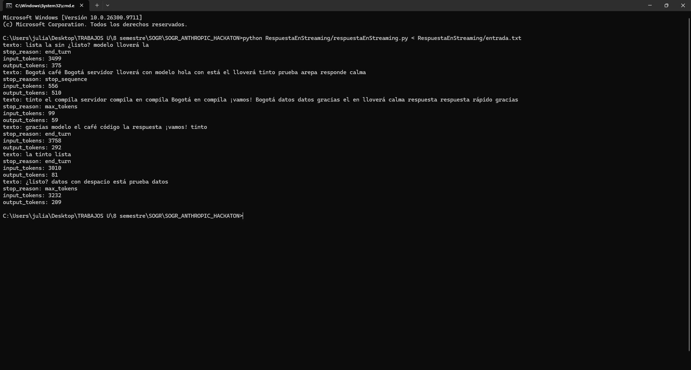
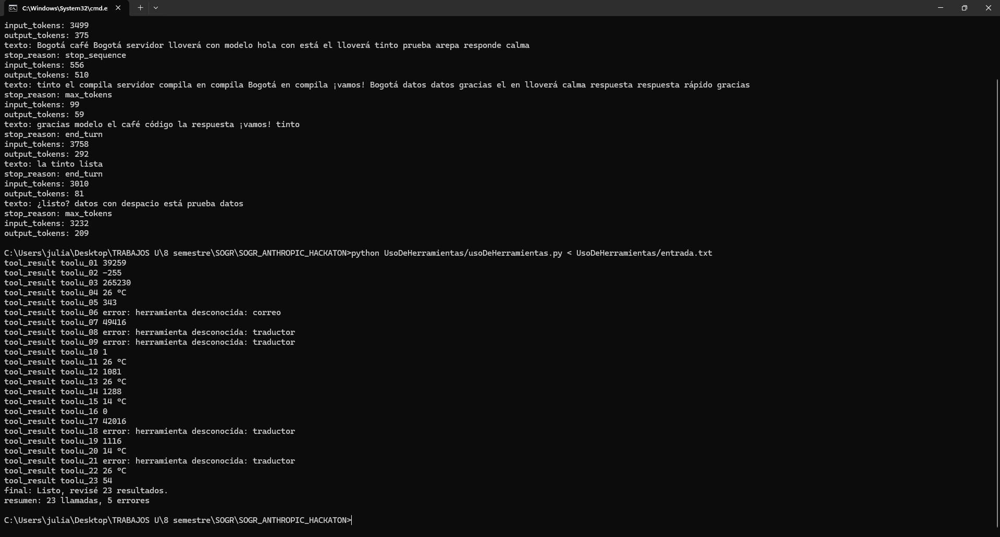
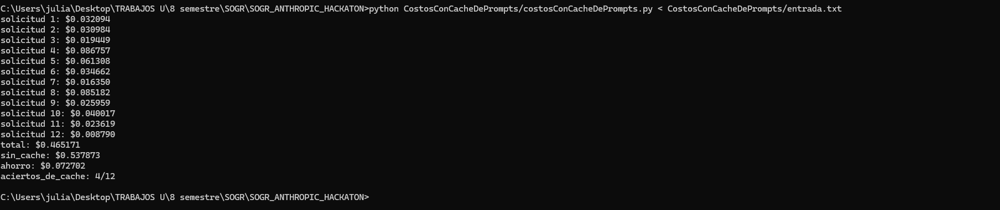
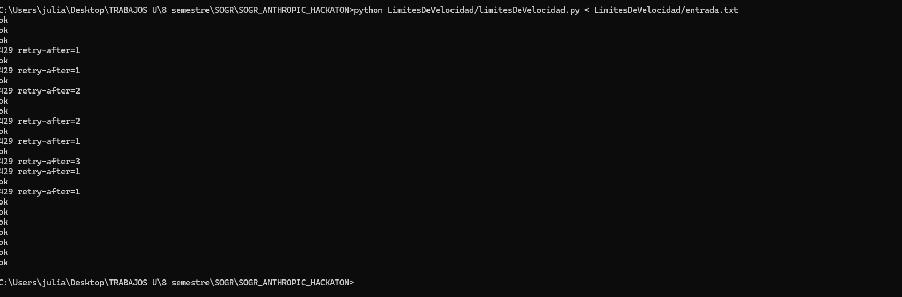
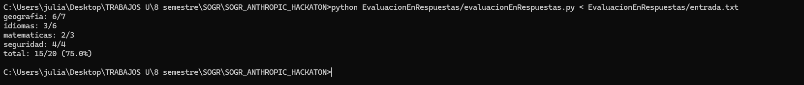

# SOGR_ANTHROPIC_HACKATON

- **Estudiante:** Julian Camilo Lopez
- **Materia:** SOGR
- **Profesor:** Martín Cantor

En estos ejercicios si utlice IA como ayuda :)

## Contenido del proyecto

Este repositorio contiene la solución en Python de cinco problemas del hackatón de Anthropic sobre la API de Claude. Cada problema tiene su propia carpeta con:

- `<nombre>.py`: la solución.
- `entrada.txt`: los casos de prueba oficiales.
- `salidaEsperada.txt`: la salida esperada del ejemplo del enunciado.
- `salida.txt`: la salida que produce el programa con `entrada.txt`.
- `evidencia/`: captura de la ejecución.

| Ejercicio | Tema | Carpeta |
|---|---|---|
| A. Respuesta en streaming | Streaming | [RespuestaEnStreaming/](RespuestaEnStreaming/) |
| B. Uso de herramientas | Tool use | [UsoDeHerramientas/](UsoDeHerramientas/) |
| C. Costos con caché de prompts | Prompt caching y precios | [CostosConCacheDePrompts/](CostosConCacheDePrompts/) |
| D. Límites de velocidad | Rate limits | [LimitesDeVelocidad/](LimitesDeVelocidad/) |
| E. Evaluación de respuestas | Evaluaciones calificadas con código | [EvaluacionEnRespuestas/](EvaluacionEnRespuestas/) |

Para ejecutar cualquiera de los ejercicios:

```bash
python RespuestaEnStreaming/respuestaEnStreaming.py < RespuestaEnStreaming/entrada.txt
```

## Evidencias

### A. Respuesta en streaming



### B. Uso de herramientas



### C. Costos con caché de prompts



### D. Límites de velocidad



### E. Evaluación de respuestas


